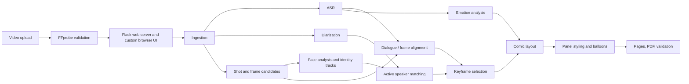

# CineComic-MML: Project Architecture and Methodology

## 1. Project purpose

CineComic-MML converts a short video into a multi-panel comic. It combines video processing, speech recognition, speaker diarization, visual character analysis, dialogue-to-frame matching, emotion estimation, page layout, image styling, and final export. A standalone HTML/CSS/JavaScript interface served by Flask provides upload validation, configuration, progress monitoring, cancellation, and result review.

This report describes the implemented pipeline and artifact flow. Its standalone HTML, CSS, and JavaScript interface is served by Flask; Flask exposes job-control APIs while the existing Python pipeline runs as a child process. Model quality depends on the source clip, model availability, hardware, and upstream stages.

## 2. System architecture



The browser loads the standalone frontend from `web/`. The Flask server handles upload, status polling, cancellation, artifact review, and downloads. It starts `main.py` as a child process, which writes pipeline output to a per-job log. Job state and copied configuration are stored under `data/jobs/<job_id>/`; source uploads are stored under `data/uploads/<job_id>/`. Intermediate phase artifacts live in `data/` and `results/`, and final pages are written under `output/<job_id>/`.

## 3. Processing phases and methods

| Stage | Purpose and method | Typical output / evidence |
|---|---|---|
| Ingestion | Validate/decode video, normalize the media inputs, extract audio, and record video metadata. FFmpeg/FFprobe are used by the input pipeline. | `data/raw/`, `data/audio/`, `data/metadata/` |
| ASR | Faster-Whisper transcribes speech into timestamped utterances; segmentation and filtering prepare readable dialogue units. | `data/subtitles/<id>.json` and subtitle artifacts |
| Diarization | Pyannote-based audio analysis assigns anonymous speaker labels and time intervals. It provides speaker turns, not real-world identities. | `data/diarization/` |
| Phase 4 | Detect scene/shot boundaries, sample candidate frames, and filter low-quality or redundant images. | `data/shots/`, `data/frames/` and stage metrics |
| Phase 5 | InsightFace-based face detection and embedding analysis builds face observations, tracks, and character clusters. This stage can be compute intensive because it analyzes sampled frames. | `data/faces/`, `data/tracks/`, face summary artifacts |
| Phase 6 | Compare dialogue and candidate-frame semantics to estimate visual relevance and dialogue/frame alignment. | alignment and embedding artifacts |
| Phase 7 | Combine speaker timing and visual face-track evidence to associate speaker turns with visible characters. | speaker-to-character matching artifacts |
| Phase 8 | Select a limited set of keyframes/panels using available visual, dialogue, and speaker evidence. | `data/keyframes/<id>.json` and selected frame images |
| Phase 9 | Estimate/fuse emotion signals for dialogue/panel presentation. This is a model estimate and may be uncertain for short or noisy utterances. | emotion annotations and metrics |
| Phase 10 | Arrange comic panels into pages using configured panel density and layout information. | layout data and metrics |
| Phase 11 | Style panel images and compose dialogue balloons with the panel content. | styled panel artifacts and metrics |
| Phase 12 | Render the final page previews/PDF and validate output structure and dialogue placement. | `output/<id>/page.json`, page PNGs, `comic.pdf` |

The phases run sequentially in the CLI's declared order. Some later phase inputs depend on outputs of earlier phases, so an upstream error can prevent downstream work. Each run's copied YAML configuration preserves its effective settings for reproducibility.

## 4. UI workflow and controls

1. Upload a supported MP4, MOV, MKV, AVI, or WEBM clip. The browser validates file type, size, and duration; FFprobe checks the actual video stream and duration at job creation. Upload size is capped at 512 MB.
2. Choose language, Whisper model, compute device, model download behavior, and panels per page. Speaker diarization requires a Hugging Face token with access to the configured gated pyannote models. The token is passed through the child process environment and is not saved in job state.
3. Start generation. The UI polls job state, shows completed stages and live Phase 5 frame progress, and exposes recent log output.
4. Stop processing to terminate the pipeline process tree. The app saves a `cancelled` job status and keeps completed intermediate artifacts. A stage interrupted mid-write may leave an incomplete artifact; rerunning creates a new job ID.
5. Review the PDF/pages, transcript, selected frames, alignment, and validation metrics. Download a per-job Markdown processing report from the Validation tab.

## 5. Run report contents

Each downloadable processing report records the job ID/status/time, input video metadata, selected settings, status for all twelve stages, the method associated with every stage, artifact availability, final output metrics when available, error/cancellation message, and captured pipeline log. It is generated from the saved job state and artifacts, so incomplete runs still document how far processing got.

## 6. Performance and operational considerations

- Phase 5 face detection is typically the most expensive visual stage. Per-job configuration uses a 512-pixel detector input and samples at 1 FPS to reduce inference calls while retaining frame-level progress and an ETA estimate.
- CPU execution is supported; CUDA acceleration is selected only when the relevant runtime/provider is available. Model initialization, cold caches, and model downloads can add substantial first-run time.
- The app currently permits one active job at a time to avoid competing for memory and GPU resources.
- A process stop is immediate at the operating-system process level. It does not attempt to roll back artifacts already written.

## 7. Repository map

- `app.py`: local Flask server entry point.
- `src/web_server.py`: browser APIs, job control, artifact serving, and report downloads.
- `web/`: standalone HTML, CSS, and JavaScript interface.
- `src/web_jobs.py`: input validation, per-job config/state, subprocess lifecycle, log parsing, and report generation.
- `main.py`: ordered CLI orchestration for ingestion and Phases 2–12.
- `configs/phase*.yaml`: stage settings; the web app copies these into each job and applies UI selections.
- `src/`: stage implementations grouped by audio, video, vision, speaker, keyframes, emotion, layout, and comic concerns.
- `data/`, `results/`, `output/`: runtime inputs, intermediate artifacts, metrics, and final deliverables.

## 8. Running locally

Install project requirements and FFmpeg/FFprobe, configure any required model access, then run:

```powershell
python app.py
```

The server listens at `http://127.0.0.1:8501` by default. Set `CINECOMIC_HOST` or `CINECOMIC_PORT` to change the local bind address or port.

The CLI can run the full staged pipeline using `python main.py --config configs/phase2.yaml --video <video-path> --video-id <id> --stages all`.

